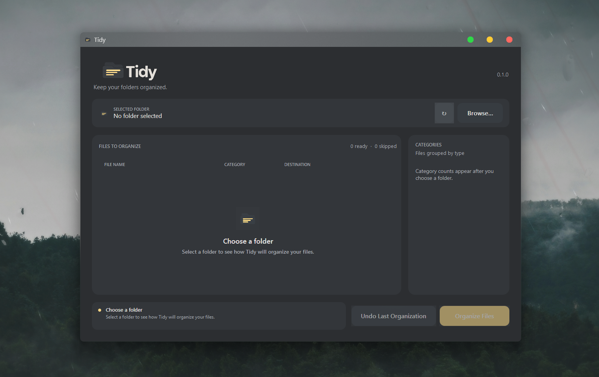

# Tidy

<p align="center"></p>

<p align="center"><em>A cleaner folder, one click away.</em></p>

Tidy is a lightweight, offline Windows 11 app that organizes top-level files into category folders. Review a read-only preview, confirm before moving anything, and undo an organization while the app remains open.



## Features

- Starts with no folder selected and keeps no recent-folder or session state.
- Scans a chosen folder asynchronously and shows a read-only plan.
- Uses a virtualized file list for large folders and supports Unicode filenames.
- Groups images, video, audio, documents, spreadsheets, presentations, archives, installers, code, and other files.
- Moves files only after confirmation, never overwrites destinations, and supports undo until the app closes.
- Uses native Windows folder selection and title-bar controls.
- No network access, telemetry, accounts, auto-start, or background service.

## Installation

For a portable build, extract `Tidy-v0.1.0-win-x64.zip` and run `Tidy.exe`. The self-contained folder includes the .NET runtime. No installer is required.

## Usage

1. Choose a folder with **Browse…** or click the empty preview area.
2. Review the automatic preview, categories, and skipped-file warnings. Use **Refresh** to rescan.
3. Choose **Organize Files**, review the confirmation, and approve the moves.
4. Choose **Undo Last Organization** before closing Tidy to restore unchanged files.

## Safety

Tidy scans only top-level files. Previewing does not alter the folder. Protected Windows and application locations, drive roots, reparse points, and shortcuts are rejected or skipped. Each move is checked against the preview again; existing destinations are handled with numbered names and the final move uses the non-overwriting filesystem operation. Permission and file-use failures appear in the results.

Undo history is held in memory only and is discarded when Tidy closes normally. Tidy does not reverse completed moves during shutdown. Undo verifies the moved file's SHA-256 contents and will not overwrite an occupied original path. A crash or power loss can interrupt a batch; no program can prevent forced termination, so review the folder if Windows shuts down unexpectedly.

## Branding

The supplied horizontal logo, folder icon, and multi-resolution Windows `.ico` are in `assets/branding/`. Transparent PNG channels were checked in the source files and retained in this project.

## Building from source

Requires Windows and the .NET 10 SDK with the Windows Desktop targeting pack.

```powershell
dotnet restore .\Tidy.sln -m:1 -p:RestoreDisableParallel=true
dotnet build .\Tidy.sln -c Release -m:1 -p:UseSharedCompilation=false
dotnet test .\tests\Tidy.Tests\Tidy.Tests.csproj -c Release
dotnet run --project .\tests\Tidy.TestRunner\Tidy.TestRunner.csproj -c Release
dotnet run --project .\src\Tidy.App\Tidy.App.csproj
dotnet publish .\src\Tidy.App\Tidy.App.csproj -c Release -r win-x64 --self-contained true -p:PublishSingleFile=false -o .\publish\win-x64
Compress-Archive -Path .\publish\win-x64\* -DestinationPath .\Tidy-v0.1.0-win-x64.zip
```

Publishing creates a folder-based self-contained portable build; it is not a single-file executable.
`Tidy.TestRunner` runs the same isolated xUnit test methods directly as a local fallback when the VSTest testhost cannot connect to its runner process.

## Contributing

Keep changes focused and offline. Discuss behavior changes before making them, and include temporary-directory tests for file-management changes. Do not test against a real Downloads folder.

## License

MIT. See [`LICENSE`](LICENSE).

